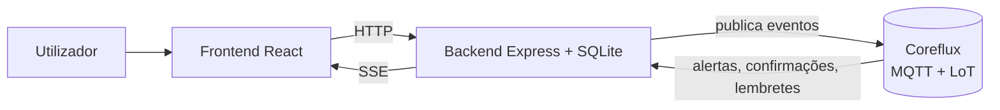

# MediPath

Assistente de saúde digital para organizar sintomas e planos de medicação, construído num hackathon de 6 horas. Usa o **Coreflux** (broker MQTT com a linguagem LoT) para processar eventos, filtrar alertas e agendar lembretes.

> **Aviso:** o MediPath é uma demonstração com dados fictícios. **Não faz diagnósticos, não recomenda medicamentos e não substitui aconselhamento médico.** Em emergência, ligue **112** (Portugal). Linha SNS 24: 808 24 24 24.

## O que faz

1. **Regista sintomas** e devolve informação geral e indicação de quando procurar ajuda (três níveis: geral, atenção, urgente). Sinais de alerta (por exemplo, dor no peito ou dificuldade em respirar) mostram uma indicação clara para ligar 112.
2. **Regista planos de medicação** já indicados por um profissional de saúde. A aplicação não sugere medicamentos.
3. **Emite lembretes** à hora do plano, agendados dentro do Coreflux.
4. **Mostra em tempo real** os eventos processados pelo Coreflux e o histórico.

## Onde o Coreflux participa

| Função | Como |
|---|---|
| Filtrar alertas | A Action `TriageAlertRouter` só reencaminha para `medipath/triage/alerts` os sintomas com urgência 1 ou 2. Sintomas ligeiros não geram evento. |
| Confirmar planos | A Action `MedicationConfirmRouter` confirma cada registo em `medipath/medication/confirmed`. |
| Agendar lembretes | Para cada plano, o backend cria no broker uma Action `Reminder_<id>` com `ON TIMESTAMP` (disparo único, em UTC). À hora marcada, **o broker** publica o lembrete em `medipath/medication/reminders`. |

A triagem de urgência corre **no backend, em código determinístico**, e não depende do broker. Se o broker estiver offline, o aviso de 112 aparece na mesma.

## Arquitetura



### Tópicos MQTT

| Tópico | Quem publica | Para quê |
|---|---|---|
| `medipath/symptoms/submitted` | Backend | Sintoma registado (inclui `urgencia` 0, 1 ou 2) |
| `medipath/triage/alerts` | Coreflux | Alertas de triagem (urgência ≥ 1) |
| `medipath/medication/registered` | Backend | Plano de medicação registado |
| `medipath/medication/confirmed` | Coreflux | Confirmação do plano |
| `medipath/medication/reminders` | Coreflux | Lembrete à hora marcada |
| `$SYS/Coreflux/Command` | Backend | Comandos de gestão (`-addAction`) |

## Estrutura do repositório

```
medipath/
├── backend/            API Express, triagem, SQLite, cliente MQTT
│   ├── server.js
│   ├── triage.js
│   ├── db.js
│   ├── deploy-coreflux.js
│   └── .env.example
├── frontend/           Interface React (Vite)
│   └── src/
└── coreflux/
    └── medipath.lot    Actions LoT
```

## Requisitos

- **Node.js 22.13 ou superior** (usa o SQLite integrado do Node). Verifique com `node -v`.
- Um **broker Coreflux** acessível (HUB cloud ou local), com utilizador e palavra-passe MQTT.

## Instalação

```bash
git clone <URL-DO-REPOSITORIO>
cd medipath

# Backend
cd backend
npm install
cp .env.example .env     # depois edite o .env com as suas credenciais

# Frontend
cd ../frontend
npm install
```

### Configuração (`backend/.env`)

```
MQTT_URL=mqtts://O-SEU-HOST.coreflux.cloud:8883
MQTT_USER=o-seu-utilizador
MQTT_PASS=a-sua-palavra-passe
```

Para um broker local sem TLS use `MQTT_URL=mqtt://localhost:1883`. **Nunca** envie o `.env` para o GitHub (já está no `.gitignore`).

## Executar

**1. Carregar as Actions no Coreflux** (só na primeira vez, ou quando `coreflux/medipath.lot` mudar):

```bash
cd backend
npm run deploy:coreflux
```

Procure `"success":true` nas respostas. Em alternativa, cole cada bloco de `coreflux/medipath.lot` no *LoT Editor* do HUB.

**2. Arrancar o backend** (porta 3001):

```bash
cd backend
npm start
```

Deve aparecer `✅ Ligado ao broker MQTT`. Pode confirmar com `curl http://localhost:3001/api/health` (esperado: `{"ok":true,"mqtt":true}`).

**3. Arrancar o frontend** (porta 5173), noutro terminal:

```bash
cd frontend
npm run dev
```

Abra **http://localhost:5173**.

## Demonstração (dados fictícios)

1. Marque **Tosse**, intensidade 2: cartão verde, **nenhum** evento do Coreflux.
2. Marque **Dor no peito**, intensidade 7: cartão vermelho com 112 e um evento em `medipath/triage/alerts`.
3. Registe um medicamento fictício (por exemplo, "Medicamento Exemplo", 1 comprimido), confirme que foi indicado por um profissional e ative o **modo demonstração**: aparece a confirmação do Coreflux e, cerca de 20 segundos depois, o lembrete.

Dica: abra o MQTT Explorer subscrito a `medipath/#` ao lado da aplicação para ver os eventos a passar pelo broker.

## API do backend

| Método | Rota | Descrição |
|---|---|---|
| POST | `/api/symptoms` | Regista sintomas e devolve a triagem |
| POST | `/api/medications` | Regista um plano e agenda o lembrete no Coreflux |
| GET | `/api/history` | Histórico de sintomas e medicação |
| GET | `/api/events` | Últimos eventos recebidos do Coreflux |
| GET | `/api/stream` | Eventos em tempo real (SSE) |
| GET | `/api/health` | Estado do servidor e da ligação MQTT |
| POST | `/api/reset` | Limpa os dados (apenas para a demonstração) |

## Segurança e privacidade

- A triagem é conservadora e nunca faz diagnóstico nem recomenda medicamentos.
- O plano de medicação só é aceite com a confirmação de que foi indicado por um profissional de saúde.
- O nome e a dose introduzidos são **sanitizados** antes de entrarem em código LoT (só letras, números e pontuação simples), para evitar injeção de código no broker.
- As credenciais ficam em `.env`, fora do controlo de versões.

## Limitações conhecidas

- A triagem é uma lista de palavras-chave **sem validação clínica**.
- Os lembretes disparam **uma só vez** (não são diários) e cada plano cria uma Action no broker, que convém apagar depois da demonstração.
- Sem contas de utilizador, autenticação nem proteção de dados de saúde (RGPD).
- O endpoint `/api/reset` não tem autenticação (só para demonstração).

## Trabalho futuro

- Lembretes recorrentes e notificações no telemóvel.
- Autenticação, contas de utilizador e conformidade com o RGPD.
- Revisão clínica das regras de triagem.
- Marcação real de consultas e integração com serviços de saúde.

## Tecnologias

React, Vite, Node.js, Express, SQLite (`node:sqlite`), MQTT.js, Coreflux (MQTT + LoT).
